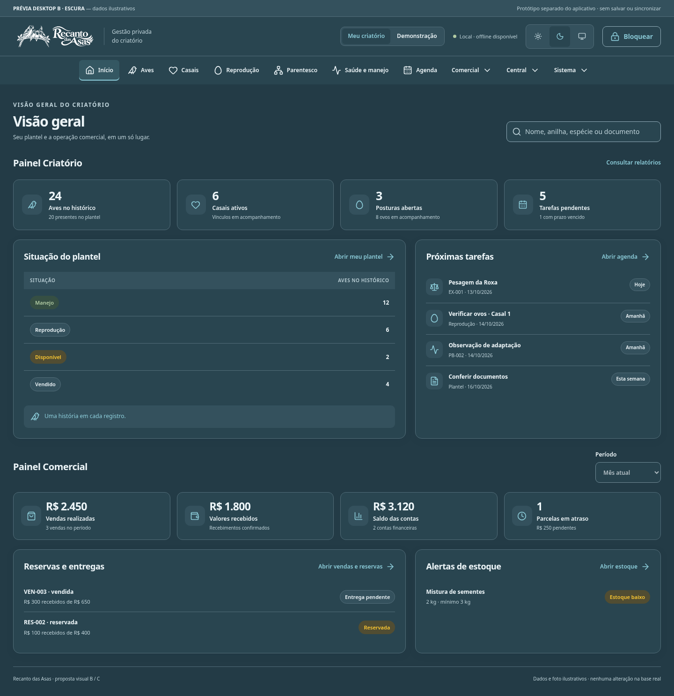
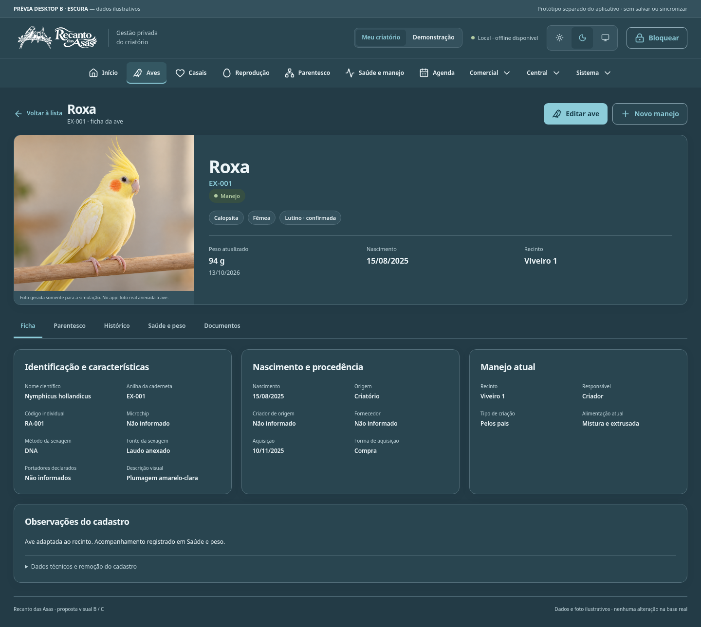
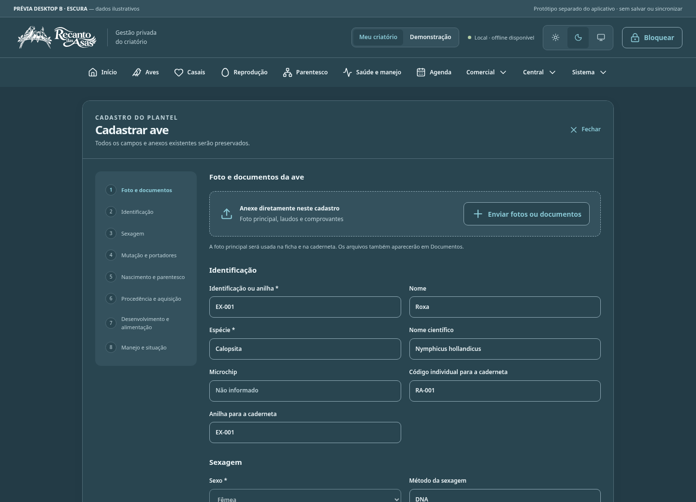
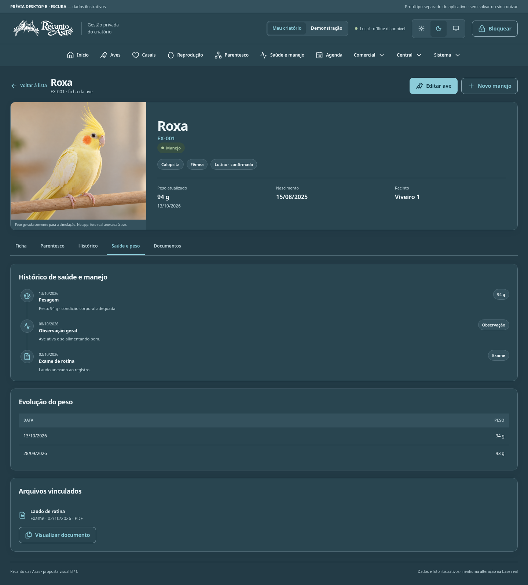

# Desktop B — escuro

[Voltar à galeria](README.md) · [Plano e auditoria](PLANO-E-AUDITORIA.md)

Simulação visual com dados ilustrativos; aplicativo e base pessoal preservados. Clique nas imagens para ampliar.

## Início

[Ver conteúdo completo](capturas/desktop-dark-home-completo.png)

## Ficha da ave

[Ver conteúdo completo](capturas/desktop-dark-profile-completo.png)

## Cadastro de ave — anexo direto

[Ver conteúdo completo](capturas/desktop-dark-form-completo.png)

## Saúde e peso — histórico da ave

[Ver conteúdo completo](capturas/desktop-dark-health-completo.png)

As capturas de telefone mostram a área inicial da tela; o conteúdo completo permanece acessível por rolagem e pelos links acima. Os formulários completos incluem os campos existentes. Nenhuma informação será removida para tornar a interface mais compacta.
