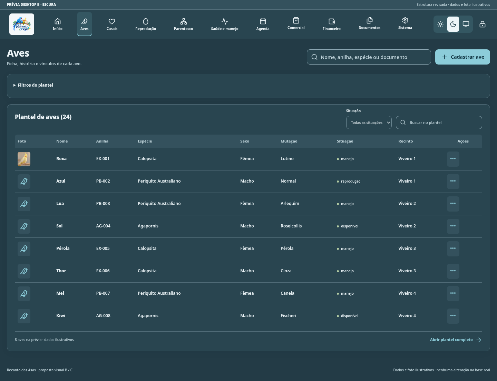

# Desktop B — escuro — revisão 2

[Voltar à galeria](README.md) · [Plano revisado](REVISAO-2-E-APROVACAO.md)

Dados e foto ilustrativos; aplicativo e base pessoal preservados. Clique nas imagens para ampliar.

## Início — lista de aves com fotos

[Ver conteúdo completo](capturas/desktop-dark-home-completo.png)

## Menu Aves — mesma apresentação com fotos

[Ver conteúdo completo](capturas/desktop-dark-birds-completo.png)

## Ficha da ave — histórico e documentos

[Ver conteúdo completo](capturas/desktop-dark-profile-completo.png)

## Cadastro de ave — anexo direto

[Ver conteúdo completo](capturas/desktop-dark-form-completo.png)

## Saúde e peso

[Ver conteúdo completo](capturas/desktop-dark-health-completo.png)

O conteúdo completo permanece acessível por rolagem e pelos links. Informações e operações do aplicativo serão preservadas.
