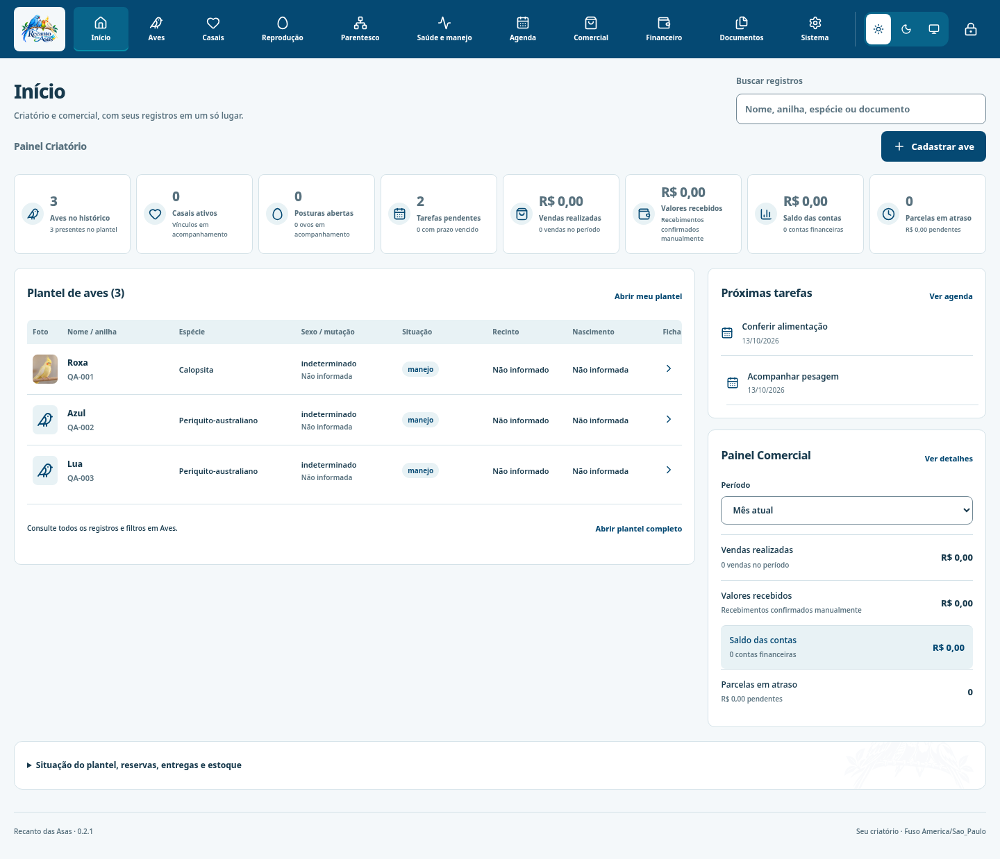
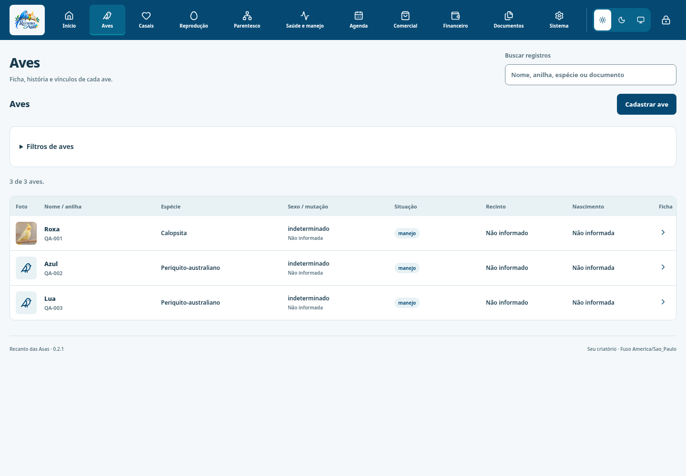
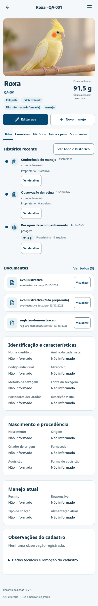
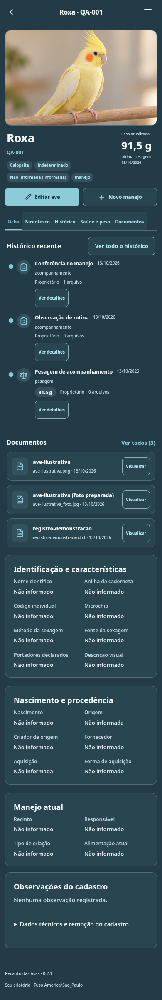

# Interface implementada — Recanto das Asas 0.2.1

Capturas da versão compilada, com a estrutura B no Windows e C no Android. Aves utiliza lista horizontal com miniaturas. Os registros e a fotografia abaixo são fictícios, usados somente em bases isoladas de teste; não são incluídos na instalação ou na base do usuário.

| Plataforma | Claro | Escuro |
|---|---|---|
| Desktop · início | [Ver](implementado/desktop-light-inicio.png) | [Ver](implementado/desktop-dark-inicio.png) |
| Desktop · lista Aves | [Ver](implementado/desktop-light-aves.png) | [Ver](implementado/desktop-dark-aves.png) |
| Desktop · ficha | [Ver](implementado/desktop-light-ficha.png) | [Ver](implementado/desktop-dark-ficha.png) |
| Android · início | [Ver](implementado/android-light-inicio.png) | [Ver](implementado/android-dark-inicio.png) |
| Android · lista Aves | [Ver](implementado/android-light-aves.png) | [Ver](implementado/android-dark-aves.png) |
| Android · ficha | [Ver](implementado/android-light-ficha.png) | [Ver](implementado/android-dark-ficha.png) |

## Desktop B — início claro

## Menu Aves — lista horizontal

## Android C — ficha clara

## Android C — ficha escura

A [galeria HTML](index.html) pode ser aberta após extrair o pacote. A pasta [anterior](anterior) conserva capturas da entrega visual anterior para comparar a estrutura; os registros de teste são diferentes. Os [resultados de validação](evidencias) acompanham as capturas. Consulte também o [relatório](../RELATORIO-REDESIGN-BC.md) e o [guia de instalação](../LEIA-PRIMEIRO.md).
