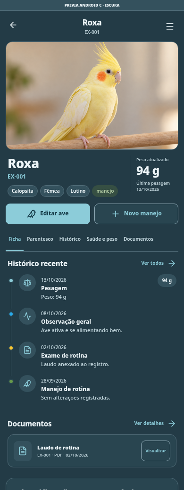

# Recanto das Asas — revisão 2 do desktop B e Android C

**Prévias revisadas para seguir a estrutura dos conceitos originais.** Aplicativo, dados e instaladores ainda não foram alterados.

- **Desktop B:** uma barra superior com logo e ícones; tabela de aves com miniaturas na coluna principal; tarefas e financeiro na lateral.
- **Android C:** cabeçalho compacto; foto; identificação e peso lado a lado; histórico vertical e documentos na ficha.
- **Início e Aves nas duas plataformas:** a mesma lista com fotos, adaptada a tabela no desktop e cartões no Android.
- **Claro e escuro:** paleta oficial e BOLD real da Noto Sans existente.

| Plataforma | Claro | Escuro |
| --- | --- | --- |
| **Desktop — conceito B** | [Ver desktop claro](DESKTOP-CLARO.md) | [Ver desktop escuro](DESKTOP-ESCURO.md) |
| **Android — conceito C** | [Ver Android claro](ANDROID-CLARO.md) | [Ver Android escuro](ANDROID-ESCURO.md) |

[**Plano revisado e propostas de correção dos travamentos**](REVISAO-2-E-APROVACAO.md) · [**Baixar as prévias em ZIP**](Previas-Desktop-B-Android-C.zip)

[Referência original B](referencias/Conceito-B.png) · [Referência original C](referencias/Conceito-C.png)

## Desktop B — claro

## Desktop B — escuro

## Android C — ficha clara e escura

| Claro | Escuro |
| --- | --- |
|  |  |

## Android — menu Aves com fotos

## Travamentos investigados

Foram reproduzidos bloqueios no processamento de backup, preparo de miniaturas e busca em saúde, além de um bug no validador Base64 para arquivos grandes. As medições em navegador com CPU reduzida não confirmam a causa específica no telefone físico. Os relatórios detalham trechos, propostas e riscos; nenhuma correção funcional foi aplicada sem autorização.

[Diagnóstico de travamentos](diagnostico/DIAGNOSTICO-TRAVAMENTOS.md) · [Diagnóstico de miniaturas](diagnostico/DIAGNOSTICO-MINIATURAS.md) · [Patch proposto](diagnostico/base64-proposto.patch)

## Explorar a proposta

Para ver as imagens, basta abrir esta galeria com sua conta do GitHub conectada. Os dados e a foto são ilustrativos, somente para esta prévia. Os arquivos sem foto mostram um estado de ausência.

O ZIP contém a galeria HTML, telas de amostra, imagens, recursos oficiais e relatórios. Extraia mantendo as pastas e abra **galeria.html**. A validação na nuvem utilizou HTTP; a abertura direta de HTML local não foi verificada porque o navegador do ambiente a bloqueia. As imagens podem ser vistas diretamente nesta página.

O protótipo não salva registros nem se conecta ao servidor privado. Os botões de operações são demonstrativos; na implementação, os eventos e operações reais serão preservados. O plano revisado prevalece sobre a composição anterior.
