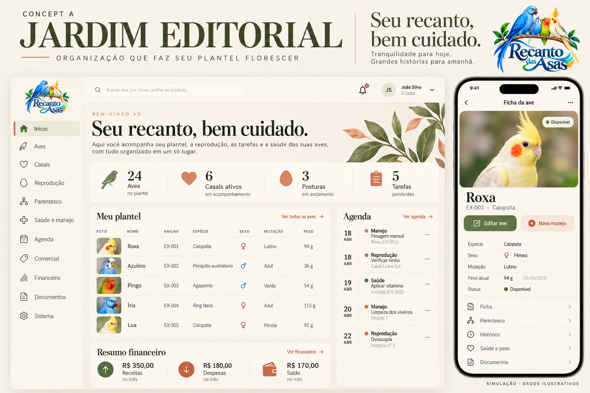
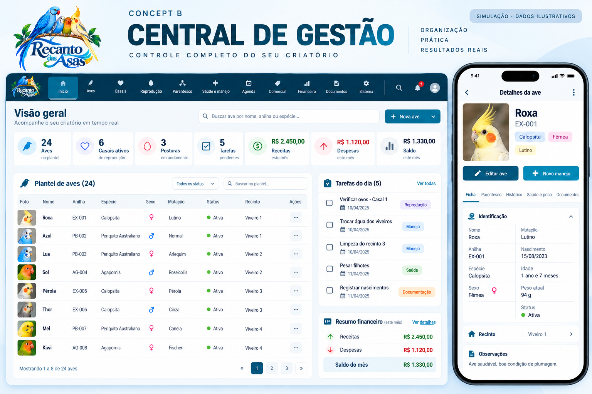
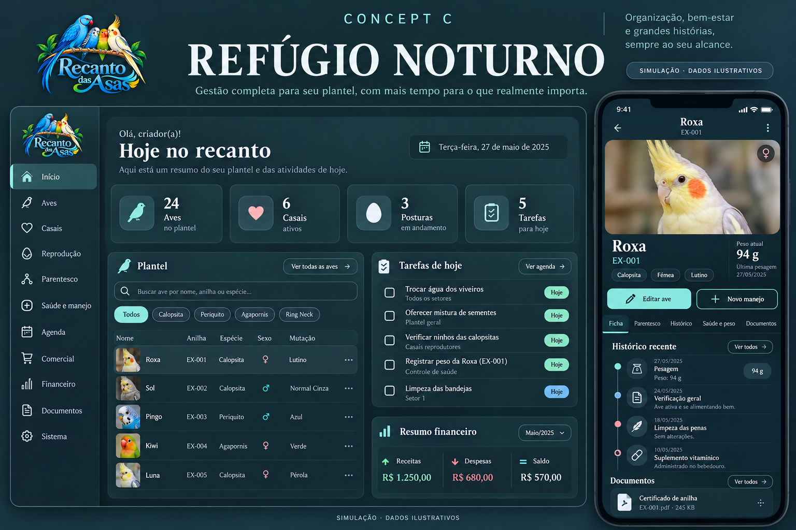

# Recanto das Asas — propostas de design

Esta galeria apresenta três simulações visuais. Elas ainda não foram aplicadas ao aplicativo. Os dados das imagens são ilustrativos.

Abra esta página no navegador, com sua conta do GitHub conectada, para ver as imagens fora do chat. Clique numa imagem para ampliá-la.

[Baixar as três imagens em ZIP](Propostas-de-Design-Recanto-das-Asas.zip)

## A — Jardim Editorial

Marfim, oliva e terracota; composição editorial, fotografias e tipografia elegante.

## B — Central de Gestão

Azul-petróleo e branco; navegação superior, tabelas e organização operacional.

## C — Refúgio Noturno

Tema escuro suave, detalhes menta, fotografia e histórico em destaque no celular.

## Guardar no Google Drive

Baixe o ZIP e extraia os três arquivos PNG. No Google Drive, use **Novo → Upload de arquivo** e selecione essas imagens. O arquivo ZIP também pode ser enviado inteiro para guardar uma cópia.

A galeria permanece no repositório privado. Os arquivos do aplicativo e a branch principal não foram alterados por esta entrega de imagens.
