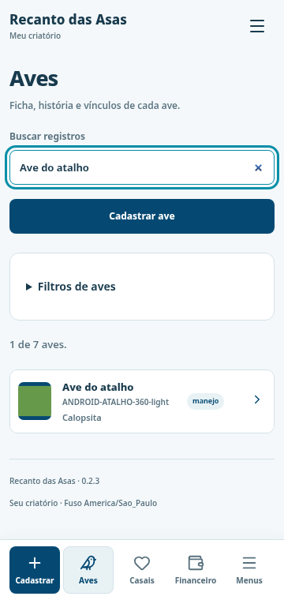
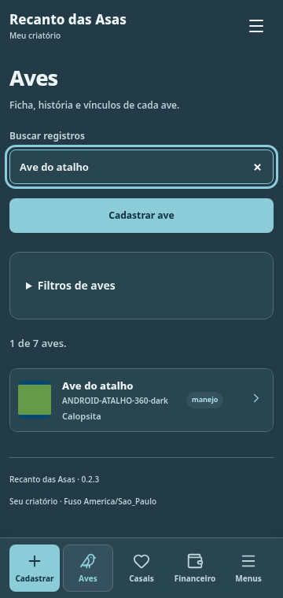
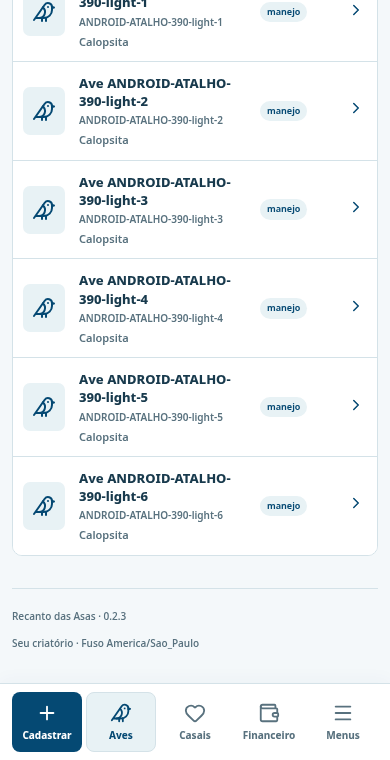
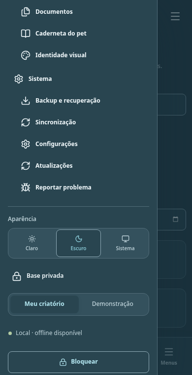

# Atalhos Android — validação 0.2.3

Os atalhos inferiores agora aparecem no APK Android, com Cadastrar, Aves, Casais, Financeiro e Menus. A barra usa os mesmos eventos existentes e os temas da identidade visual.

Veja as [instruções de instalação e o escopo da mudança](../ATUALIZACAO_0.2.3.md). As capturas e os testes desta pasta usam somente bases isoladas com registros fictícios.

## Revisão de preservação

Uma revisão independente do diff verificou que `App.tsx` e os eventos da barra não mudaram. Banco, persistência, autenticação, sincronização e versões de dependências permanecem iguais. O menu conserva `flex-wrap: nowrap`, o espaçamento inferior da página comporta a barra e a ordem de camadas mantém menus e modais acima dela. Miniaturas maiores permanecem restritas à plataforma web; o instalador Windows conserva a apresentação anterior.

O [registro de preservação](evidencias/preservacao.json) compara os arquivos existentes por SHA-256 com a versão 0.2.2 e compara integralmente as entradas das dependências no lockfile.

## Evidências

- [Testes unitários](evidencias/vitest.json): 269 aprovados, zero falhas.
- [Testes específicos de atalhos](evidencias/playwright-atalhos.json): 11 aprovados, zero falhas, ignorados ou instáveis. Cobrem os cinco atalhos, cancelar/reabrir cadastro, salvar e recuperar registros, busca, fotos, rolagem sem sobreposição, os menus existentes e temas claro/escuro. A apresentação Android foi exercitada em 360, 390 e 1280 px; uma redução de viewport para 430 px de altura aproxima o espaço ocupado pelo teclado nos telefones, sem simular o teclado nativo em si.
- Build de produção: TypeScript e Vite concluídos. O aviso já existente sobre importação dinâmica de `exports.ts` permanece; esta alteração não refatora o módulo.
- [Verificação do APK](evidencias/apk-verification.json): código 2004, mesma assinatura e pacote, mesmas permissões e 94 arquivos do build correspondentes, incluindo os dois workers no cache offline. Lint Android: zero erros, 30 avisos e cinco sugestões já existentes.
- [Verificação adicional](evidencias/additional-verification.json): 221 PNGs nativos idênticos aos anteriores; backup Android e tráfego HTTP continuam desativados. Só o Android foi empacotado nesta entrega.
- [Manifesto dos recursos compilados](evidencias/dist-manifest.json) e [tamanho e SHA-256 do APK](../ARTEFATOS_0.2.3.json).

A [rodada geral de navegador](evidencias/playwright.json) aprovou 66 testes em 237 segundos, sem falhas, ignorados ou instáveis, incluindo os fluxos existentes de gestão, arquivos, relatórios, caderneta, persistência, temas e menu. O ambiente não tem telefone físico; Chromium simula a escolha de plataforma Android para verificar a apresentação e os eventos reais da aplicação.

## Capturas de apresentação

As 18 capturas da [pasta capturas](capturas) incluem telefones e tablet nos dois temas. [Manifesto e limitações](capturas/manifest.json).
