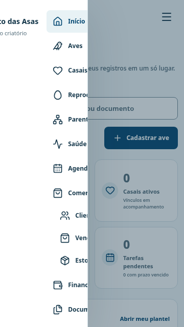
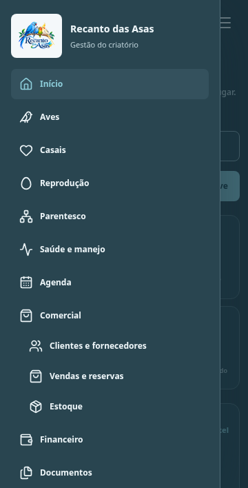
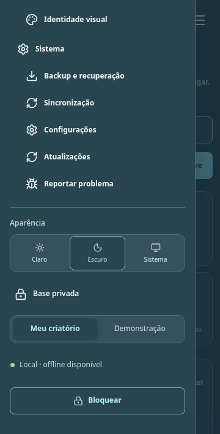
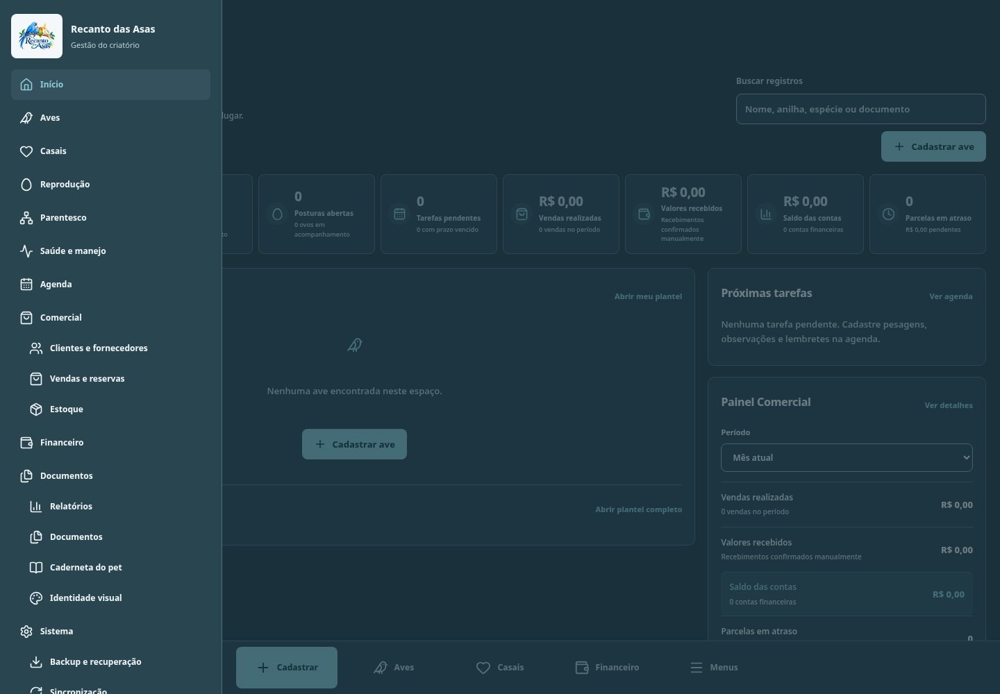
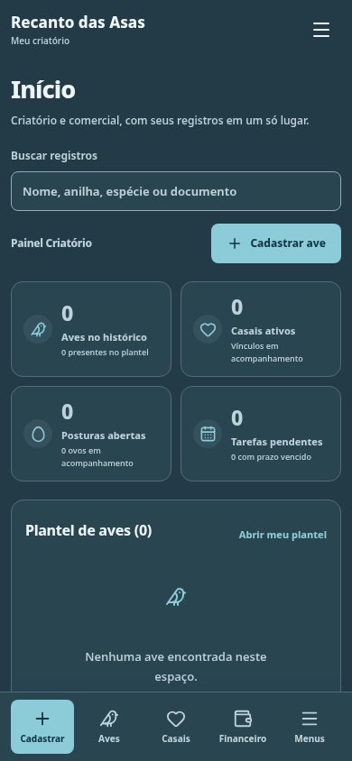
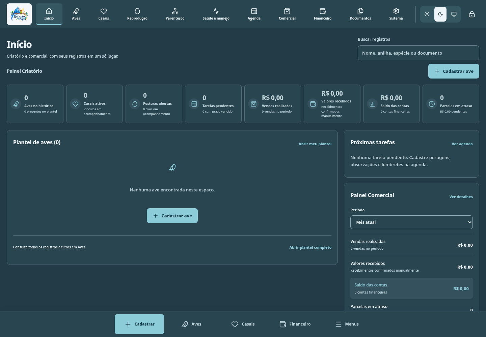

# Correção do menu 0.2.2

Reprodução em bases isoladas de teste: a gravação e os registros reais do usuário não foram incluídos.

## Antes: menu dividido em colunas

## Depois: uma coluna e rolagem vertical

## Todos os menus pelo atalho web

Veja a [análise e instalação](../ATUALIZACAO_0.2.2.md) e os [resultados de validação](evidencias).

## Atalhos fixos no navegador

